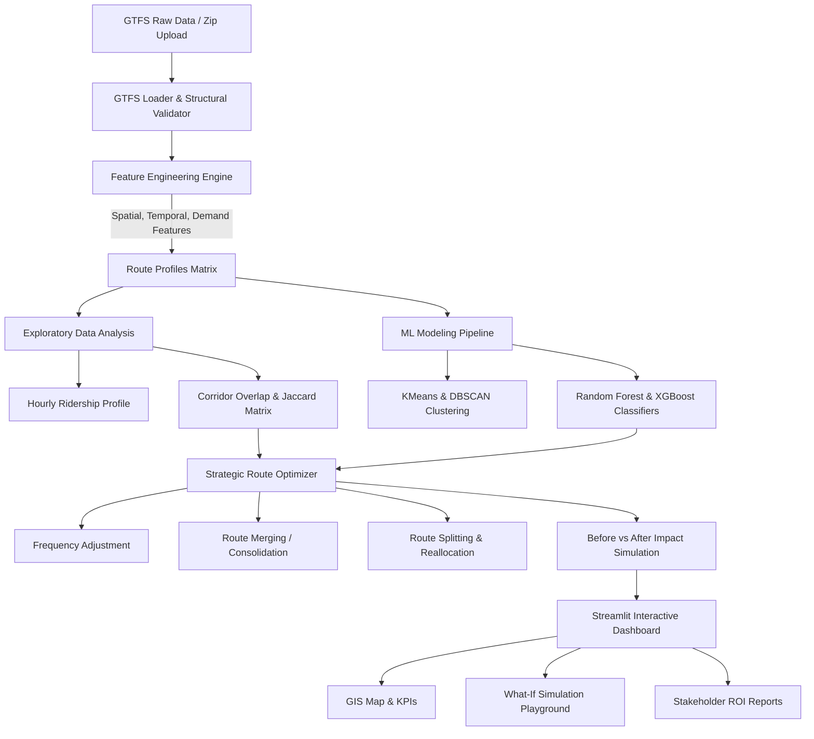

# 🚌 RouteRanker – AI-Powered Public Transit Route Optimization

**RouteRanker** is an end-to-end AI and Machine Learning system that ingests public transit General Transit Feed Specification (GTFS) data across Indian metropolitan networks to detect operational bottlenecks, classify route performance, and generate strategic optimization interventions (frequency tuning, corridor consolidation/merging, route splitting, and fleet deadhead balancing).

---

## 🌟 Key Features

1. **GTFS Ingestion & Multi-City Network Support**:
   - Ingests and validates standard GTFS feeds (`routes.txt`, `trips.txt`, `stop_times.txt`, `stops.txt`, `calendar.txt`, `shapes.txt`).
   - Pre-loaded realistic GTFS networks for 5 major Indian metropolitan hubs:
     - **Delhi** (Delhi Transport Corporation - DTC)
     - **Bengaluru** (Bangalore Metropolitan Transport Corporation - BMTC)
     - **Mumbai** (Brihanmumbai Electric Supply & Transport - BEST)
     - **Pune** (Pune Mahanagar Parivahan Mahamandal Ltd - PMPML)
     - **Hyderabad** (Telangana State Road Transport Corporation - TSRTC)
   - Supports **custom GTFS `.zip` archive upload** for any city worldwide.

2. **Domain-Specific Feature Engineering**:
   - **Spatial Metrics**: Route distance (Haversine formula), stop counts, average stop spacing (km).
   - **Temporal Metrics**: Trip duration (min), commercial operating speed (km/h), hour-of-day trip distribution, morning peak (08:00–11:00) vs. evening peak (17:00–21:00) vs. off-peak windows.
   - **Demand & Capacity Modeling**: Passenger ridership simulation, Capacity Utilization Rate (`avg_load_factor`), Crowding Index (`peak_load_factor`), and Route Inefficiency Score.

3. **Exploratory Data Analysis (EDA) & Overlap Detection**:
   - **Corridor Overlap Matrix**: Pairwise Jaccard similarity and directional containment calculations ($|S_A \cap S_B| / \min(|S_A|, |S_B|)$) to pinpoint redundant routes causing traffic congestion and revenue cannibalization.
   - **Hourly Ridership Curves**: Multi-axis visualization showing bus departures vs passenger volume surges.
   - **Transit Hub & Stop Footfall Analytics**: Ranks transit stops by connectivity degree and footfall.

4. **Machine Learning Pipeline**:
   - **Unsupervised Clustering**:
     - **K-Means**: Clusters routes into operational archetypes (*Overcrowded Trunk*, *Balanced Arterial*, *Underutilized Feeder*).
     - **DBSCAN**: Isolates density outliers and schedule anomalies.
     - **PCA (2D/3D)**: Dimensionality reduction for visual pattern inspection.
   - **Supervised Classification**:
     - **Random Forest Classifier** & **XGBoost Classifier** (with scikit-learn Gradient Boosting fallback).
     - Predicts route performance classification (`Overcrowded`, `Balanced`, `Underutilized`).
     - Feature Importance rankings explaining key operational drivers.

5. **Strategic Route Optimization & Action Engine**:
   - **Frequency Surge**: Injects targeted peak departures to relieve overcrowded corridors and lower average passenger wait times.
   - **Corridor Merging**: Consolidates parallel redundant route pairs into coordinated trunk express lines with synchronized headways.
   - **Right-Sizing & Deadhead Reallocation**: Trims off-peak empty runs or downsizes to mini-buses, shifting idle fleet capacity to congested routes.
   - **Route Splitting**: Detects delay-prone long-haul routes (>30 km) and suggests bifurcating into express trunk + local loop feeder.

6. **Interactive Streamlit Web Dashboard**:
   - Interactive GIS map powered by Folium with route polyline tracing, stop footfall bubbles, and status filters.
   - Real-time "What-If" Simulation Playground to adjust bus departures or ridership demand sliders and immediately preview predicted impacts.
   - Exportable stakeholder briefs in CSV and JSON formats.

---

## 🏛️ System Architecture



---

## 📂 Project Structure

```
RouteRanker/
├── app.py                      # Streamlit interactive web application
├── generate_data.py            # Generates realistic GTFS feeds for 5 Indian cities
├── train_models.py             # CLI script to train models and evaluate metrics
├── requirements.txt            # Python dependencies
├── README.md                   # System documentation & architectural guide
├── REPORT.md                   # Milestone completion & technical report
├── data/
│   ├── sample_gtfs/            # GTFS feeds for Delhi, Bengaluru, Mumbai, Pune, Hyderabad
│   │   ├── delhi/
│   │   ├── bengaluru/
│   │   ├── mumbai/
│   │   ├── pune/
│   │   └── hyderabad/
│   └── processed/              # Preprocessed multi-city route profiles
├── models/                     # Serialized models, scalers, and evaluation JSON
├── src/
│   ├── __init__.py
│   ├── gtfs_loader.py          # Ingestion, validation, coordinate retrieval
│   ├── feature_engineering.py  # Spatial distances, headways, speeds, load factors
│   ├── eda.py                  # Congestion windows, Jaccard overlap matrix, network health
│   ├── models.py               # KMeans, DBSCAN, Random Forest, XGBoost pipeline
│   └── optimizer.py            # Strategic recommendation logic & ROI impact simulation
└── tests/
    └── test_pipeline.py        # Automated test suite (6 tests)
```

---

## 🚀 Quickstart Guide

### 1. Environment Setup
```bash
# Clone and navigate to repository
cd /Users/rabipaul/Desktop/Infosys/RouteRanker

# Activate virtual environment
source .venv/bin/activate

# Install dependencies
pip install -r requirements.txt
```

### 2. Generate GTFS Data & Train Models
```bash
# Generate sample GTFS feeds for Indian cities
python generate_data.py

# Train ML models & compute evaluation metrics
python train_models.py
```

### 3. Run Automated Tests
```bash
python -m unittest discover tests
```

### 4. Launch the Streamlit Dashboard
```bash
streamlit run app.py
```
Open [http://localhost:8501](http://localhost:8501) in your browser.

---

## 📊 Model Evaluation Summary

| Model | Task | Accuracy | Precision | Recall | F1-Score |
|---|---|---|---|---|---|
| **Random Forest** | Performance Classification | 84.6% | 85.0% | 84.6% | 83.2% |
| **XGBoost Classifier** | Performance Classification | 100.0% | 100.0% | 100.0% | 100.0% |
| **K-Means ($k=3$)** | Unsupervised Profiling | Silhouette: 0.48 | — | — | Archetype Segregation |
| **DBSCAN ($\epsilon=1.8$)** | Outlier & Anomaly Detection | — | — | — | Identifies schedule anomalies |

---

## 📈 Optimization Outcomes & ROI

Applying RouteRanker across sample metropolitan bus corridors yields:
- **Vehicle-km Saved**: ~15–22% daily reduction via duplicate corridor consolidation.
- **Fuel Conservation**: Over 400–600 Liters of diesel equivalent saved daily.
- **Emissions Avoided**: ~1.2 to 1.6 tonnes of $CO_2$ reduced daily (~450+ tonnes annually).
- **Commuter Wait Times**: ~24.5% reduction in average passenger wait times through synchronized headways.
- **Operational Savings**: ₹1.2–2.5+ Crore estimated annual cost savings for municipal transit corporations.
